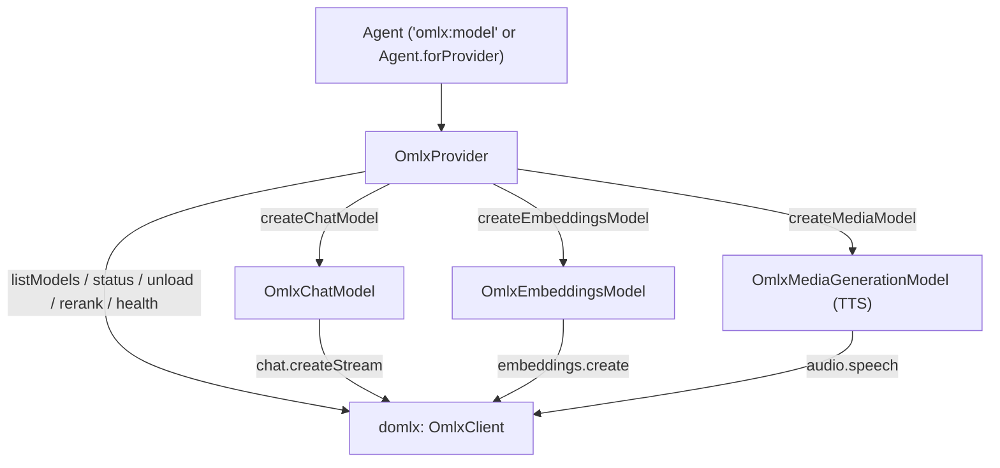

# `dartantic_omlx` Provider Implementation Plan

Implement a complete Dartantic AI provider package for **oMLX** in `/Users/rx/dev/projects/dartantic_omlx` using the local [`domlx`](file:///Users/rx/dev/labz/locallm/locallm/domlx/lib/domlx.dart) client SDK and following the architecture of [`packages/dartantic_ai/lib/src/providers`](file:///Users/rx/dev/labz/forks/dartantic/packages/dartantic_ai/lib/src/providers).

---

## Architecture Overview



---

## Proposed File Structure

All files will be created inside `/Users/rx/dev/projects/dartantic_omlx`:

```text
/Users/rx/dev/projects/dartantic_omlx/
├── pubspec.yaml
├── analysis_options.yaml
├── lib/
│   ├── dartantic_omlx.dart
│   └── src/
│       ├── providers/
│       │   └── omlx_provider.dart
│       ├── chat_models/
│       │   ├── omlx_chat.dart
│       │   ├── omlx_chat_model.dart
│       │   ├── omlx_chat_options.dart
│       │   └── omlx_message_mappers.dart
│       ├── embeddings_models/
│       │   ├── omlx_embeddings.dart
│       │   ├── omlx_embeddings_model.dart
│       │   └── omlx_embeddings_model_options.dart
│       ├── media_gen_models/
│       │   ├── omlx_media_gen.dart
│       │   ├── omlx_media_gen_model.dart
│       │   └── omlx_media_gen_model_options.dart
│       └── shared/
│           └── omlx_utils.dart
├── test/
│   ├── omlx_provider_test.dart
│   ├── omlx_chat_model_test.dart
│   ├── omlx_message_mappers_test.dart
│   ├── omlx_embeddings_model_test.dart
│   └── omlx_media_gen_model_test.dart
└── example/
    └── main.dart
```

---

## Detailed Component Design

### 1. Package Configuration ([`pubspec.yaml`](file:///Users/rx/dev/projects/dartantic_omlx/pubspec.yaml))
- Declare direct dependencies already resolved in `pubspec.lock`:
  - `dartantic_ai: ^3.4.2`
  - `dartantic_interface: ^4.0.1`
  - `domlx: { path: /Users/rx/dev/labz/locallm/locallm/domlx }`
  - `http: ^1.6.0`
  - `logging: ^1.3.0`
  - `meta: ^1.18.0`
  - `uuid: ^4.5.3`

---

### 2. Provider: `OmlxProvider` (`lib/src/providers/omlx_provider.dart`)
Modelled after [`OllamaProvider`](file:///Users/rx/dev/labz/forks/dartantic/packages/dartantic_ai/lib/src/providers/ollama_provider.dart) and [`OpenAIProvider`](file:///Users/rx/dev/labz/forks/dartantic/packages/dartantic_ai/lib/src/providers/openai_provider.dart):
- Extends `Provider<OmlxChatOptions, OmlxEmbeddingsModelOptions, OmlxMediaGenerationModelOptions>`.
- **Defaults**:
  - `name`: `'omlx'`
  - `aliases`: `const ['mlx']`
  - `displayName`: `'oMLX'`
  - `defaultBaseUrl`: `Uri.parse('http://localhost:8000')`
  - `defaultApiKeyName`: `'OMLX_API_KEY'` (optional — local oMLX servers do not require an API key unless started with `--api-key`).
  - `defaultModelNames`:
    - `ModelKind.chat`: `'mlx-community/Qwen2.5-7B-Instruct-4bit'`
    - `ModelKind.embeddings`: `'bge-micro'`
    - `ModelKind.media` / `ModelKind.tts`: `'mlx-community/Kokoro-82M-bf16'`
    - `ModelKind.audio`: `'whisper-large-v3'`
- **Agent Registry Integration**:
  - `static void register([OmlxProvider Function()? factory])`: Registers `'omlx'` and `'mlx'` in `Agent.providerFactories` so `Agent('omlx:mlx-community/Qwen2.5-7B-Instruct-4bit')` works seamlessly.
- **Core `Provider` methods**:
  - `createChatModel(...)`: Instantiates `OmlxChatModel` with merged `OmlxChatOptions` and `enableThinking`.
  - `createEmbeddingsModel(...)`: Instantiates `OmlxEmbeddingsModel` with `OmlxEmbeddingsModelOptions`.
  - `createMediaModel(...)`: Instantiates `OmlxMediaGenerationModel` for local TTS audio generation.
  - `listModels()`: Uses `OmlxClient.models.list()` (`GET /v1/models`), infers `Set<ModelKind>` from model IDs (`embeddings`, `tts`, `audio`, `image`, `chat`, `other`), and yields `dartantic_interface.ModelInfo` with extra metadata.
- **oMLX Extensions on `OmlxProvider`**:
  - `Future<domlx.HealthResponse> health()`: Calls `GET /health`.
  - `Future<List<domlx.ModelStatus>> modelsStatus()`: Calls `GET /v1/models/status`.
  - `Future<domlx.UnloadModelResponse> unloadModel(String modelId)`: Calls `POST /v1/models/{model_id}/unload` to free Apple Silicon unified memory.
  - `Future<List<domlx.RerankResult>> rerank(...)`: Calls `POST /v1/rerank` for semantic document reranking.
  - `Future<domlx.AudioTranscriptionResponse> transcribeAudio(...)`: Calls `POST /v1/audio/transcriptions` (Whisper STT).

---

### 3. Chat Model & Mappers (`lib/src/chat_models/`)

#### `OmlxChatOptions` (`omlx_chat_options.dart`)
Extends `ChatModelOptions`:
- `double? temperature`
- `double? topP`
- `int? topK`
- `double? repetitionPenalty`
- `int? maxTokens`
- `domlx.ResponseFormat? responseFormat`
- `dynamic toolChoice` (`'auto'`, `'none'`, `'required'`, or function choice map)
- `List<String>? stop`
- `String? user`
- `Duration? timeout`
- `Map<String, dynamic>? extra` (passed through to `domlx.ChatCompletionRequest.extra`)

#### `OmlxChatModel` (`omlx_chat_model.dart`)
Extends `ChatModel<OmlxChatOptions>`:
- Wraps `domlx.OmlxClient`.
- Implements `sendStream(List<ChatMessage> messages, {OmlxChatOptions? options, Schema? outputSchema})`:
  - Streams SSE chunks via `_client.chat.createStream(request)`.
  - Emits text deltas as `TextPart` in `ChatResult.output`.
  - **Reasoning / Thinking support**:
    - Maps `chunk.firstReasoningContent` (`reasoning_content` from oMLX) to `ThinkingPart` in `ChatResult.output.parts` **and** `ChatResult.thinking` for real-time streaming and `DefaultStreamingOrchestrator` consolidation.
  - **Tool Calling support**:
    - Accumulates streaming `ToolCall` deltas (supporting both single-chunk and multi-chunk argument streaming, and generating fallback UUIDs via `ToolIdHelpers` when `id` is empty).
    - Emits complete `ToolPart.call(...)` parts when the stream completes.
  - **Structured Output (`outputSchema`)**:
    - Converts `Schema` into `domlx.ResponseFormat.jsonSchema(name: 'output_schema', schema: ..., strict: true)`.
  - **Usage & Prefix Cache Metadata**:
    - Maps `domlx.Usage` (`promptTokens`, `completionTokens`, `totalTokens`) to `LanguageModelUsage`.
    - Surfaces oMLX-specific metrics (`cached_tokens`, `prefill_duration`, `generation_duration`) in `ChatResult.metadata`.

#### `omlx_message_mappers.dart`
- Bidirectional mapping between `dartantic_interface` (`ChatMessage`, `Part`, `TextPart`, `DataPart`, `LinkPart`, `ToolPart`, `ThinkingPart`, `Tool`) and `domlx` (`ChatMessage`, `ContentPart`, `Tool`, `ToolCall`, `FunctionCall`).
- Expands multi-tool-result user messages into individual `role: 'tool'` messages as required by OpenAI-compatible endpoints.
- Encodes image `DataPart`s as `data:<mimeType>;base64,<data>` in `domlx.ContentPart.imageUrl` and `LinkPart` image URLs directly.

---

### 4. Embeddings Model (`lib/src/embeddings_models/`)

#### `OmlxEmbeddingsModelOptions` (`omlx_embeddings_model_options.dart`)
Extends `EmbeddingsModelOptions`:
- `super.dimensions`
- `super.batchSize`
- `String? encodingFormat` (`'float'` or `'base64'`)
- `String? user`

#### `OmlxEmbeddingsModel` (`omlx_embeddings_model.dart`)
Extends `EmbeddingsModel<OmlxEmbeddingsModelOptions>`:
- Uses `domlx.OmlxClient.embeddings.create(...)`.
- Implements `embedQuery` and `embedDocuments` with batch chunking (`batchSize`, default `512`).
- Accumulates token usage into `LanguageModelUsage` and includes oMLX cache/timing details in `metadata`.

---

### 5. Media Generation Model (`lib/src/media_gen_models/`)

#### `OmlxMediaGenerationModelOptions` (`omlx_media_gen_model_options.dart`)
Extends `MediaGenerationModelOptions`:
- `String voice` (default `'af_heart'` or `'alloy'`, supporting Kokoro/oMLX voices)
- `String? responseFormat` (`'mp3'`, `'wav'`, `'opus'`, `'aac'`, `'flac'`, `'pcm'`)
- `double? speed`

#### `OmlxMediaGenerationModel` (`omlx_media_gen_model.dart`)
Extends `MediaGenerationModel<OmlxMediaGenerationModelOptions>`:
- Validates requested `mimeTypes` (supports `audio/*`, `audio/mp3`, `audio/mpeg`, `audio/wav`, `audio/opus`, `audio/aac`, `audio/flac`, `audio/pcm`).
- Invokes `_client.audio.speech(AudioSpeechRequest(...))` and yields a `MediaGenerationResult` containing a `DataPart` with the synthesized audio bytes and `isComplete: true`.

---

### 6. Verification & Testing Plan
1. **Unit Tests (`test/`)**:
   - Mock `http.Client` injected into `OmlxProvider` / `OmlxChatModel` / `OmlxEmbeddingsModel` / `OmlxMediaGenerationModel` to test:
     - Provider registration with `Agent.providerFactories` and `Agent('omlx:...')` instantiation.
     - Model listing (`listModels`), status, unload, health, and rerank.
     - Chat streaming with text deltas, `<think>` / `reasoning_content` thinking deltas, tool calls + tool results roundtrip, multimodal image inputs, structured output (`outputSchema`), and oMLX usage/cache metrics.
     - Embeddings single query and batched document embeddings.
     - Media generation (TTS audio synthesis).
2. **Static Analysis & Execution**:
   - Run `dart analyze` and `dart test` on `/Users/rx/dev/projects/dartantic_omlx`.
